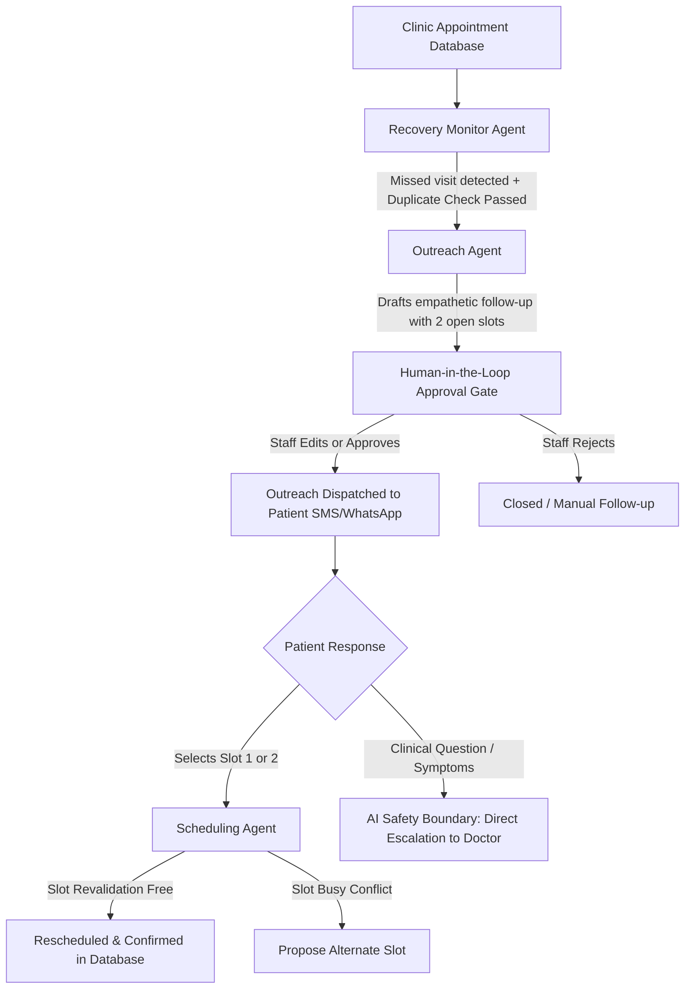

# CareLoop AI: Healthcare Clinic Portal & Recovery System
**Closed-Loop Missed Appointment Recovery with Human-in-the-Loop Oversight & Supabase Cloud**

CareLoop AI is an agentic healthcare operations platform designed to solve the multi-billion dollar problem of clinic no-shows and lost patient follow-ups. Instead of being a passive chatbot that waits for patient questions, CareLoop AI operates as a proactive **Closed-Loop Recovery Engine**. It automatically detects missed visits, drafts personalized empathetic follow-ups, requires explicit clinic staff approval before any message is sent, revalidates appointment slots to prevent double-booking, and safely hands off any clinical questions to human physicians.

Built for the **Agentika 2.0** competition aligned with the evaluation rubric (Healthcare Operations domain, Fastn MCP, Supabase Cloud / Alternate Clouds).

---

## Key System Capabilities

1. **Closed-Loop Recovery Architecture**:
   - **Recovery Monitor Agent**: Continuously tracks appointment statuses, flags missed visits, and enforces duplicate-prevention rules so patients never receive repetitive messages.
   - **Outreach Agent**: Drafts personalized SMS/WhatsApp follow-ups suggesting 2-3 available clinic recovery slots, strictly adhering to non-clinical AI safety boundaries.
   - **Scheduling Agent**: Revalidates calendar slot availability before confirming rebookings to prevent race conditions and double-booking.
2. **Human-in-the-Loop Approval Gate**:
   - Every patient-facing communication pauses in a `Pending Approvals` queue.
   - Clinic receptionists or doctors can **Approve & Send**, **Edit the message** before dispatch (Hero Moment for competition judges), or **Reject / Escalate** to a direct phone call.
3. **AI Safety & Clinical Boundaries**:
   - The AI is strictly prohibited from providing medical advice, diagnosing diseases, or recommending drug dosages.
   - Any patient reply mentioning clinical keywords (e.g., chest pain, fever, bleeding, prescription, dosage) immediately triggers the **AI Safety Boundary**, transitioning the case directly to the Doctor's Queue.
4. **Cloud Database with Local Fallback**:
   - **Supabase Cloud (PostgreSQL)**: Production-ready cloud backend with Row Level Security (RLS) and real-time tables.
   - **Local SQLite Fallback**: Automatic, zero-configuration local mode with identical schema if cloud credentials are not yet configured.
5. **Interactive Clinic Web Portal**:
   - **Patient Portal**: Instant appointment booking with date/time picker (no account required).
   - **Reception Desk**: Live appointments table, search, status workflow (`Scheduled`, `In lobby`, `With doctor`, `Completed`, `Missed`).
   - **Doctor Consultation Queue**: Real-time waiting queue with one-click "Start Consultation" and "Mark Consulted".
   - **4-Column AI Recovery Board**: Live Kanban view (`Missed Visits` -> `Proposed Actions` -> `Pending Approvals` -> `Recovered / Escalated`).
   - **Competition Demo Simulator**: Test patient replies live (Happy Path, Clinical Safety Boundary, and Slot Race Condition).

---

## Architecture Flow



---

## Supabase Database Setup

CareLoop AI includes a production SQL schema for Supabase in `backend/supabase_schema.sql`.

### 1. Create Supabase Project
1. Go to [supabase.com](https://supabase.com) and create a free project.
2. Open the **SQL Editor** in your Supabase dashboard.
3. Copy the contents of `backend/supabase_schema.sql` and run it. This creates:
   - `appointments`: Patient records, visit reasons, dates, times, and statuses.
   - `pending_approvals`: Human-in-the-loop approval gate for drafted outreach.
   - `audit_logs`: Live chronological tool-call trace and agent decision history.
   - `inventory`: Clinic pharmacy and supply catalog.

### 2. Configure Environment Variables
Copy `backend/.env.example` to `backend/.env` and paste your Supabase Project URL and anon key:

```env
SUPABASE_URL=https://your-project-id.supabase.co
SUPABASE_KEY=your-supabase-anon-or-service-role-key
PORT=8000
HOST=127.0.0.1
```

> **Note**: If `SUPABASE_URL` is omitted, CareLoop AI automatically runs in local SQLite mode (`careloop.db`) without any errors.

---

## Installation & Running

### Prerequisites
- Python 3.10+ (Python 3.12 recommended)
- Web browser (Chrome, Edge, Firefox, Safari)

### 1. Set Up Environment
```bash
# Windows
py -3.12 -m venv .venv
.\.venv\Scripts\Activate.ps1

# Linux / macOS
python3 -m venv .venv
source .venv/bin/activate
```

### 2. Install Dependencies
```bash
pip install -r requirements.txt
```

### 3. Run the Server
```bash
python main.py
```

Open your browser to:
- **Clinic Web Portal**: [http://127.0.0.1:8000](http://127.0.0.1:8000)
- **Interactive API Documentation (Swagger)**: [http://127.0.0.1:8000/docs](http://127.0.0.1:8000/docs)

---

## 6-Minute Live Competition Demo Script

| Timestamp | Screen / Action | What to Demonstrate & Talk Track | Rubric Criterion |
|---|---|---|---|
| **0:00 - 0:45** | Portal Home | **The Healthcare Problem**: 30 synthetic clinic appointments loaded. Highlight that clinics lose 20-30% revenue to missed visits, leading to worsening patient health. Introduce CareLoop AI not as a chatbot, but as a closed-loop recovery engine. | Real-World Impact |
| **0:45 - 2:00** | Reception & Recovery Board | **Detection & Human Gate**: Show Maryam Farooq's missed visit. Click "⚡ Run AI Recovery Scan". Show how the Recovery Monitor passes the duplicate check and Outreach Agent drafts an empathetic follow-up. | Technical Execution |
| **2:00 - 3:15** | Pending Approval Card | **The Hero Moment**: Open the pending approval card. Click "Edit Message". Personalize the doctor's name, then click "Approve & Send SMS". Show judges that human staff is 100% in control. | Human + AI Alignment |
| **3:15 - 4:15** | Simulator Modal | **Safety Boundary**: Click "🧪 Simulator". Select Scenario B (Patient asks: *"My chest hurts, can I take Panadol?"*). Click Simulate. Show that AI refuses clinical advice, flags the safety boundary, and moves the patient straight to Dr. Imran's Doctor Queue! | AI Safety & Creativity |
| **4:15 - 5:15** | Simulator Modal | **Slot Revalidation (Scenario A)**: Simulate patient selecting "1". Show Scheduling Agent revalidating calendar slot availability, preventing double-booking, and confirming the rescheduled visit. | Automation Depth & MCP |
| **5:15 - 6:00** | Live Audit Trace | **Explainability & Metrics**: Show the live Audit Feed displaying timestamps, agent transitions, and the database status pill showing Supabase Cloud live connectivity. | UX & Presentation |

---

## API Endpoints Reference

### Healthcare Operations
- `GET /health`: Health status, database mode (`supabase` vs `sqlite_local`), pending approval count.
- `GET /api/stats`: Live summary metrics (registered patients, missed, recovered %, in lobby, etc.).
- `GET /api/appointments`: List appointments with optional `status` and `search` query parameters.
- `POST /api/appointments`: Book a new appointment from patient portal.
- `PATCH /api/appointments/{id}/status`: Receptionist/Doctor status update.
- `GET /api/approvals`: List pending human-in-the-loop approvals.
- `POST /api/approvals/{id}/approve`: Approve an outreach message (with optional message editing!).
- `POST /api/approvals/{id}/reject`: Discard/reject a pending outreach message.
- `POST /api/recovery/scan`: Trigger AI Recovery Monitor scan across all missed visits.
- `POST /api/recovery/simulate-reply`: Live demo simulator for patient replies.
- `GET /api/audit-logs`: Chronological audit log of all agent decisions and state changes.
- `POST /api/seed`: Reset and seed the 30 synthetic pilot appointments.

### Clinic ERP & Pharmacy
- `GET /inventory`: List clinic medicines and supplies.
- `POST /inventory`: Add new stock item.
- `POST /orders`: Adjust stock levels (with decision policy safety thresholds).
- `GET /tools`: List discovered Fastn MCP tools.

---

## License
MIT License. Developed for Agentika 2.0 Competition.
